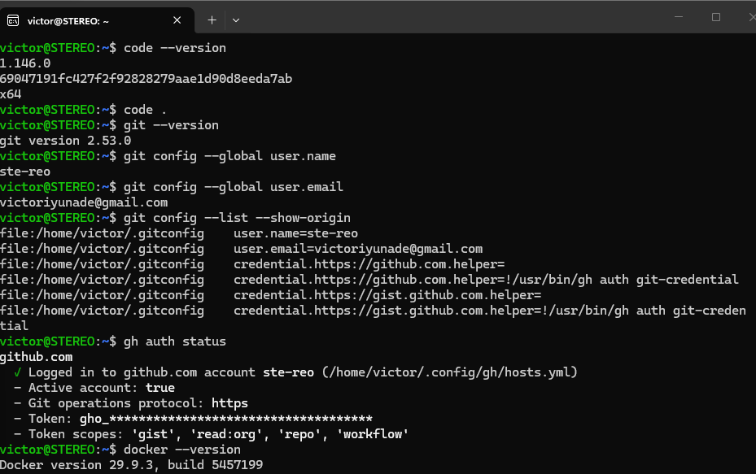
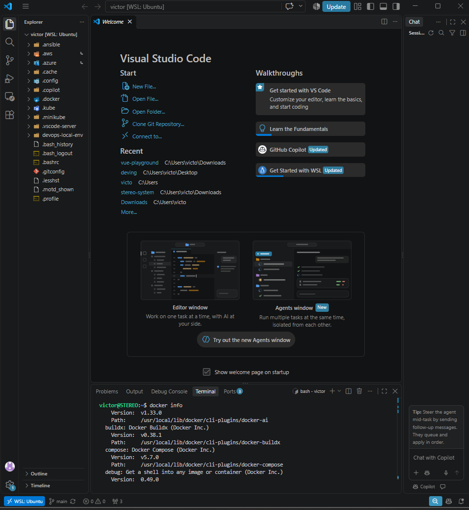
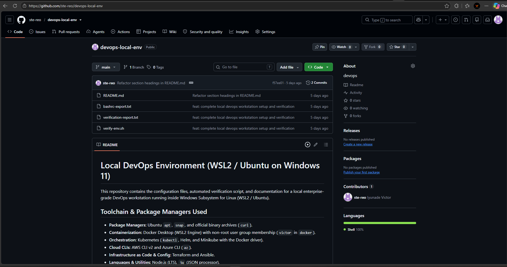
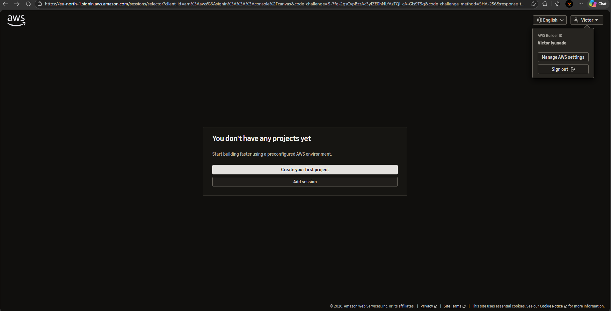
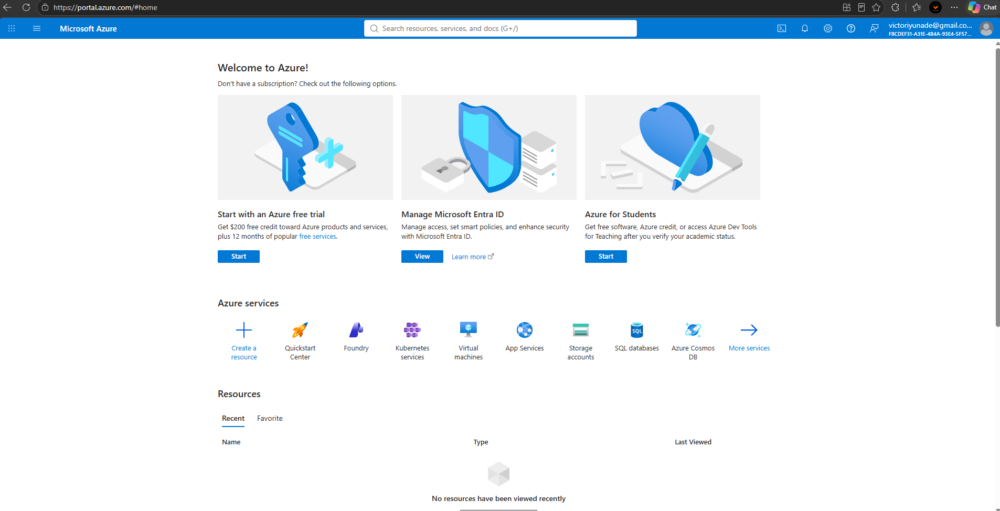
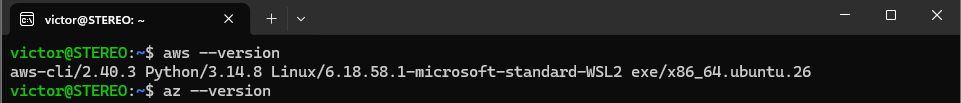
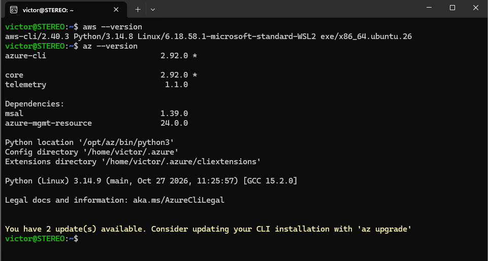

# Local DevOps Environment (WSL2 / Ubuntu on Windows 11)

This repository contains the configuration files, automated verification script, and documentation for a local enterprise-grade DevOps workstation running inside Windows Subsystem for Linux (WSL2 / Ubuntu).

##  Toolchain & Package Managers Used
* **Package Managers:** Ubuntu `apt`, `snap`, and official binary archives (`curl`).
* **Containerization:** Docker Desktop (WSL2 Engine) with non-root user group membership (`victor` in `docker`).
* **Orchestration:** Kubernetes (`kubectl`, Helm, and Minikube with the Docker driver).
* **Cloud CLIs:** AWS CLI v2 and Azure CLI (`az`).
* **Infrastructure as Code & Config:** Terraform and Ansible.
* **Languages & Utilities:** Node.js (LTS), `jq` (JSON processor).

##  Verification Report Summary
All 11 required tools and security permissions are validated automatically via `verify-env.sh`. 

##  Troubleshooting & Key Solutions
1. **Minikube Docker Driver Error (`DRV_UNSUPPORTED_OS`):** 
   - *Cause:* Minikube was launched before confirming an active bridge to Docker Desktop.
   - *Fix:* Ensured Docker Desktop was running on Windows, verified the socket connection with `docker ps`, set the default driver (`minikube config set driver docker`), and ran `minikube start`.
2. **WSL2 File Permissions:**
   - Secured sensitive configuration folders (`~/.ssh` and `~/.kube`) to `700` permissions.

---

## Installation & Account Setup Proof

| Tool / Account | Verification Screenshot |
| :--- | :--- |
| **Git Installation & Config** |  |
| **VS Code (WSL Integration)** |  |
| **GitHub Account & Repo** |  |
| **AWS Console Account** |  |
| **Azure Portal Account** |  |
| **AWS CLI Installation** |  |
| **Azure CLI Installation** |  |
